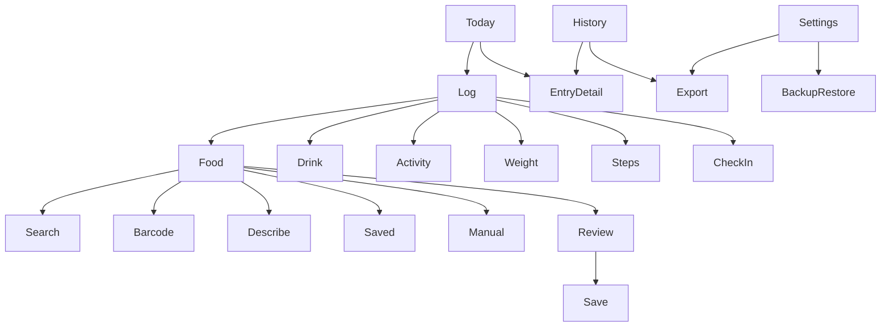

# Experience and visual specification

Version 0.1 — proposed layouts and design direction, not approved final artwork.

## 1. Interaction principles

1. Start with the action the user wants: log, repeat, review, or export.
2. Place frequent actions near the lower part of the screen for one-handed use on the S25 Ultra.
3. Reveal detail progressively. Names and quantities come before full nutrition and metadata.
4. Keep drafts when the keyboard closes, the app backgrounds, or a provider fails.
5. Give immediate feedback and an Undo action for quick saves and deletes.
6. Use neutral language: “Logged today,” “Add a meal,” and “No entries yet.” Avoid guilt, streak penalties, food grades, and compulsory targets.

## 2. Navigation

Bottom navigation: Today, History, Trends. A persistent, clearly labeled Log control opens Food/Meal, Drink, Activity, Weight, Steps, and Check-in. Food, Drink, and Activity receive the strongest visual emphasis.

Library opens from food logging and a secondary menu. Settings contains units, goals, reminders, appearance, privacy/source information, export, backup/restore, and data deletion. Export is also reachable from History so it is not buried.



## 3. First use

One short welcome introduces the journal and export capability. Let the user choose units and appearance, then go directly to Today. Weight, goals, account creation, and notifications are not required to begin.

Ask camera permission when Scan is selected. Denial leaves manual barcode input and search available. Explain online nutrition lookup when first used. Notification permission is requested only if the user turns on reminders. An optional microphone is a later enhancement; typing a meal description is part of the first release.

## 4. Today

Proposed hierarchy:

```text
Newleaf                         Settings
Today, Thursday Oct 1          Date picker

Water 32 US fl oz     Steps: Add
Logged calories 840 · partial nutrition

Quick water      [8 oz] [16 oz] [24 oz]

Your day
08:15  Breakfast       Eggs and toast
       View details · Add how you felt
09:00  Coffee          12 US fl oz
12:30  Lunch           Chicken sandwich
17:10  Walk            1.8 mi · 35 min

Daily note                       Add

[Today] [History] [Trends]       [Log +]
```

Values above are layout examples, not a nutrition recommendation. Tiles can be reordered or hidden. Body weight appears as an optional tile or timeline row. If goals are off, show plain totals rather than empty progress rings. A missing step entry displays Add; explicit zero displays 0.

Timeline cards show time, name, a compact portion/summary, and a small type indicator. Source and detailed nutrition live behind a tap. A meal can expand into its food and drink components; its calorie summary includes linked drinks once. Standalone drink rows remain visible, with a subtle meal association when applicable.

## 5. Food and meal flow

### Search

Open a search field with recent foods and favorites below it. Local matches can update while typing; remote requests are debounced and obey provider limits. Show a loading state without wiping local matches. Display food name, brand, preparation, usual serving, and a source label. Use exact product identity to distinguish raw/cooked foods and similarly named brands.

Selecting a result opens portion review. Quantity receives focus, with available unit choices and a live nutrition preview. Save adds the item to the meal draft; the user can add another item or finish. Expanded fields hold preparation, notes, custom nutrition, and photos.

### Scan

Open a camera view with a simple scan boundary, flashlight, manual-code option, and Back. Pause recognition after one code is captured to prevent repeated requests. A match opens the product/portion screen. A missing or incomplete match offers search or a custom food with the barcode retained. Do not claim “no calories” when data is absent.

### Describe

Show a large text box labeled “Describe foods” and one example: “2 eggs, 1 cup milk.” Accept up to eight comma/newline items with optional quantity and unit. “Find suggestions” is an explicit action that sends food queries directly from the phone to free USDA FoodData Central search with the personal key; a configured gateway is an optional fallback. Direct access separates the item list locally and keeps the original description on the phone. This is a bounded item-list lookup; it does not interpret arbitrary prose or infer complete meal nutrition. Preserve the original text locally. On response, show each provisional USDA match and quantity, with parsed amounts visibly marked as unverified estimates. Fetch selected USDA details while retaining the incoming quantity/unit hints, inference flags, and original text. Review distinguishes an unspecified quantity from an unverified parsed amount and flags unsupported units; it leaves missing quantities blank. Require explicit food and portion confirmation before adding an item. Allow changing its amount, deleting it, adding a missing item, and classifying a drink.

The final review groups the meal's items and totals. The original list remains visible so the user can identify missing or unmatched foods. “Save meal” saves only the reviewed draft and remains disabled during the save itself to prevent duplicates. Failed lookup offers manual continuation using the same text. Unsupported portion conversions and missing nutrients remain unknown.

Settings lists only the free sources: Open Food Facts barcode lookup requires no account, key, or gateway. USDA food search and Describe require free personal API-key signup at [the official USDA registration page](https://fdc.nal.usda.gov/api-key-signup/). A masked personal key field is the main setup option; no hosting is needed. The key is protected on the phone with Android Keystore and excluded from exports and backups. An advanced gateway section starts collapsed and offers optional URL/device-token fallback when the personal key is blank; shared provider keys stay on that gateway. No subscription or paid nutrition service is activated. Search/Describe send food queries directly to USDA with the personal key or through the optional gateway, and barcode lookup sends only the barcode to Open Food Facts. Manual logging and exports work offline.

### Saved meals and recipes

Favorites are reachable immediately from the food sheet. A saved meal opens with its usual portions prefilled; Confirm saves it with today's time. “Repeat” from a prior meal opens the same review. Recipe creation is a secondary library flow: add ingredients, select yield, optionally enter cooked weight, review nutrients, save.

## 6. Drink flow

Show Water first, followed by favorite drinks. A favorite carries its usual volume and composition. Main inputs are drink, volume, unit, and time. Expand for milk/sugar additions, nutrition, notes, or meal association.

Quick water presets save in one tap, update the total immediately after a successful local write, and display Undo. Repeated taps represent separate drinks; prevent only accidental duplicate submission of the same in-flight save. Undo removes the last identified entry, not whichever entry happens to be latest after an unrelated change.

## 7. Feelings, activity, and weight

Meal detail offers “How did you feel?” with tag chips and optional ratings. Time defaults to now; “Observed earlier” changes it. If there are multiple check-ins, show their elapsed times and let the user edit each one.

Activity asks for type first, then optional distance/duration. Steps has a separate daily-total sheet showing the existing total before replacement. Weight opens a decimal keypad with the preferred lb/kg unit and an editable timestamp. Neither weight nor activity requires notes.

Deleting a meal with linked feelings or drinks offers an explicit choice: delete its dependent check-ins or keep them as unlinked observations; keep linked drinks as standalone entries or delete them. The undo operation restores the chosen set atomically.

## 8. History, trends, and exports

History offers date navigation, search, and type filters without a complicated calendar dashboard. Editing a historical entry shows its date prominently. Moving an entry to another date refreshes both dates' totals.

Trends use simple line/bar charts with range selectors, readable units, counts, and visible missing-data gaps. Chart details explain known totals, averaging, and coverage in ordinary language. Always provide an accessible text/table equivalent.

Export flow: select date range, select format, select notes/attachments/library options, review counts and any source restrictions, then Save or Share using Android's system controls. Cancel returns without claiming success. Backup and restore are separate labeled actions so users understand which files can fully restore the journal.

## 9. Visual direction

Proposed palette:

| Role | Light | Dark |
| --- | --- | --- |
| Canvas | warm ivory `#F7F5EF` | deep charcoal `#171C19` |
| Surface | `#FFFFFF` | `#222A25` |
| Primary text | `#202B24` | `#F2F5F0` |
| Accent | forest `#356449` | soft leaf `#9CCCAF` |
| Secondary accent | muted clay | muted clay, adjusted for contrast |

Use a restrained leaf motif, simple outline icons, low elevation, soft separators, and rounded surfaces. Keep headings around 24–30 sp, body around 16 sp, and supporting labels around 14 sp, subject to font scaling. Choose a licensed readable typeface during visual review. Proposed spacing uses 4/8/12/16/24/32 dp, with 16–24 dp page margins and 16–20 dp card radii.

This is a custom component system; avoid default Material color schemes, prominent floating circles, and wallpaper-driven colors. Android permission dialogs, pickers, and share sheets remain familiar platform controls. Compose is a proposed implementation tool, not a requirement to adopt Material visuals.

## 10. Accessibility and quality targets

- At least 48 dp touch targets and readable contrast; validate palette combinations before implementation.
- Support TalkBack names, logical focus, large text, dark mode, and reduced motion preferences.
- Never communicate data status with color alone; pair Estimated/Unknown with text.
- Keep primary actions visible above the keyboard and respect gesture/status-bar insets.
- Test on the S25 Ultra at the owner's font/display settings, plus a smaller emulator layout.
- Proposed usability targets: a repeated meal within 10 seconds; a water favorite in one tap; a common searched meal within 30 seconds excluding provider delay. Validate these through use, not by assertion.
