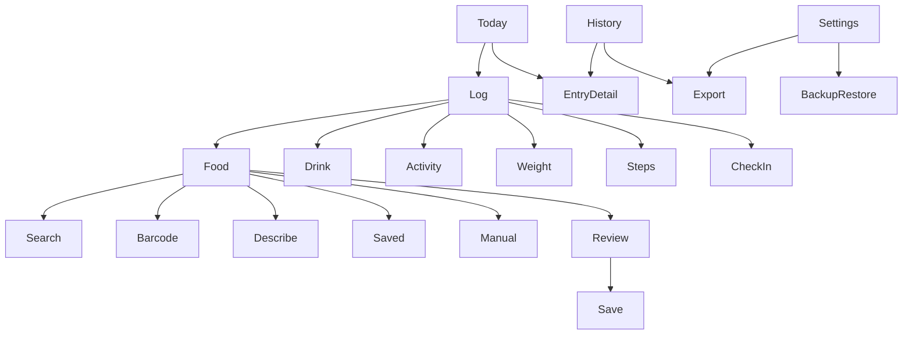

# Experience and visual specification

Further simplicity revision — October 2, 2026. Editor changes are implemented; parent compilation, device validation and main-screen direct-scan integration are pending.

## 1. Interaction principles

1. Start with the action the user wants: log, repeat, review, or export.
2. Place frequent actions near the lower part of the screen for one-handed use on the S25 Ultra.
3. Reveal detail progressively. Names and quantities come before full nutrition and metadata.
4. Keep drafts when the keyboard closes, the app backgrounds, or a provider fails.
5. Give immediate feedback and an Undo action for quick saves and deletes.
6. Use neutral language: “Logged today,” “Add a meal,” and “No entries yet.” Avoid guilt, streak penalties, food grades, and compulsory targets.

## 2. Navigation

Bottom navigation: Today, History, Trends, with selected-state accessibility semantics. The persistent “Log” control opens three main choices: Food, Drink, Activity. “More ways to log” reveals Meal, Weight, Steps, Check-in, and Daily note. Meal is the multiple-item flow; Food supports a name-only entry. Saved drafts can be continued from a collapsed Saved drafts section, keeping the main choices clear on a populated installation.

The main-screen “Scan” control opens the direct flow: capture → automatic Open Food Facts lookup → “Log scanned item” → “Add to journal”. The review lets the user choose a required Breakfast/Lunch/Dinner/Snack/Other category and Food/Drink classification. No record is created until Add to journal.

Library opens through “Saved foods & recipes” in Settings. Settings contains units, goals, reminders, appearance, privacy/source information, export, backup/restore, and data deletion. Export is also reachable from History so it is not buried.



## 3. First use

One short welcome introduces the journal and export capability. Let the user choose units and appearance, then go directly to Today. Weight, goals, account creation, and notifications are not required to begin.

Ask camera permission before opening the scanner when Scan is selected. Denial shows a plain in-editor explanation and leaves manual barcode input and search available, instead of opening a scanner camera-error dialog. The scanner stays in portrait orientation. Explain online nutrition lookup when first used. Notification permission is requested only if the user turns on reminders. An optional microphone is a later enhancement; typing a meal description is part of the first release.

## 4. Today

Proposed hierarchy:

```text
Newleaf                         Settings
Today, Thursday Oct 1

Calories 840     Water 32 oz     Steps: Add

[+ 16 oz water]

Your day
08:15  Breakfast       Eggs and toast
       View details · Add how you felt
09:00  Coffee          12 US fl oz
12:30  Lunch           Chicken sandwich
17:10  Walk            1.8 mi · 35 min

[Today] [History] [Trends]       [Log] [Scan]
```

Values above are layout examples, not a nutrition recommendation. Today keeps one compact Calories/Water/Steps summary, one 16 oz quick-water shortcut, and the timeline. Empty state says “Nothing logged yet”. Custom drink sizes and Daily note remain in Log; date navigation is in History. If goals are off, show plain totals rather than empty progress rings. A missing step entry displays Add; explicit zero displays 0.

Timeline cards show time, name, a compact portion/summary, and a small type indicator. Source and detailed nutrition live behind a tap. A meal can expand into its food and drink components; its calorie summary includes linked drinks once. Standalone drink rows remain visible, with a subtle meal association when applicable.

## 5. Food and meal flow

### Everyday entry and search

Food and drink entry begin with “What did you have?”, a name, optional amount/volume, a unit dropdown, optional calories, and an optional meal dropdown. A name-only entry is valid. One Save action remains above the keyboard. No Manual/Search/Barcode method menu appears initially. “Find a food” reveals a Find by dropdown with Name or Barcode; meal composition also offers Food list for assisted multi-item lookup. “Back to entry” abandons lookup without discarding typed entry fields or the retained barcode.

Amount units and categories use readable dropdowns. Meal categories start blank and include Breakfast, Lunch, Dinner, Snack and Other. Existing custom categories remain selectable; the multiple-item meal editor retains custom category input under More details. Search requests remain explicit, with loading, scoped failure and review states. Choosing a match opens portion review; explicit Confirm updates the editor draft, then Save records it.

More details contains nutrition beyond calories, favorites/library, classification, amount evidence, custom units, notes/photos and date/time. Drink additions remain there and contribute once. Source details are secondary. Missing values remain unknown.

### Scan

Open a camera view with a simple scan boundary, flashlight, manual-code option, and Back. Pause recognition after one code is captured to prevent repeated requests. A captured code immediately starts free Open Food Facts lookup and opens the populated product/portion review on a match, without a separate result-card tap. Typed codes use “Find product” and then follow the same review path. The review shows product name, brand/source, reported portion, and scaled calories. It labels a populated starting amount as a product-label reference, not detected consumption. Editable nutrition, custom units, amount evidence and source details share one Details group. Food/Drink classification uses a visible Log as dropdown. The consumed amount must be reviewed. A missing provider portion stays blank rather than defaulting to one serving; absent nutrition remains unknown. Inside an ordinary editor, “Confirm item” updates the local draft and the editor Save persists it separately. For the main-screen quick scan, the same dialog uses “Log scanned item” and one “Add to journal” action; its callback carries the reviewed category, classification, quantity and nutrition to the parent persistence flow. Busy state blocks duplicate Add, Cancel and dismiss; save errors remain visible for retry. Canceling review leaves the journal unchanged.

Lookup progress and failure/not-found feedback appear at the top of the barcode controls. Progress disables duplicate requests and journal save. Unexpected failures use fixed wording; only sanitized NutritionException messages are displayed. Cancellation is checked again after lookup so abandoned results cannot reopen review. Switching Search/Describe methods cancels the preceding request and clears results; request identity checks stop older responses from replacing current results. Failure or no match keeps the code in the locally recoverable draft and visible and offers “Try barcode again”, manual product entry with the barcode retained, or a switch to name search. Camera cancellation leaves the current draft untouched; manual barcode entry remains available when camera access is declined. The fake capture and lookup hooks are used only by offline UI tests; production uses Android scanning and NutritionClient.barcode.

### Describe

Show a large text box labeled “Describe foods” and one example: “2 eggs, 1 cup milk.” Accept up to eight comma/newline items with optional quantity and unit. “Find suggestions” is an explicit action that sends food queries directly from the phone to free USDA FoodData Central search with the personal key; a configured gateway is an optional fallback. Direct access separates the item list locally and keeps the original description on the phone. This is a bounded item-list lookup; it does not interpret arbitrary prose or infer complete meal nutrition. Preserve the original text locally. On response, show each provisional USDA match and quantity, with parsed amounts visibly marked as unverified estimates. Fetch selected USDA details while retaining the incoming quantity/unit hints, inference flags, and original text. Review distinguishes an unspecified quantity from an unverified parsed amount and flags unsupported units; it leaves missing quantities blank. Require explicit food and portion confirmation before adding an item. Allow changing its amount, deleting it, adding a missing item, and classifying a drink.

The final review groups the meal's items and totals. The original list remains visible so the user can identify missing or unmatched foods. “Save meal” saves only the reviewed draft and remains disabled during the save itself to prevent duplicates. Failed lookup offers manual continuation using the same text. Unsupported portion conversions and missing nutrients remain unknown.

Settings lists only the free sources: Open Food Facts barcode lookup requires no account, key, or gateway. USDA food search and Describe require free personal API-key signup at [the official USDA registration page](https://fdc.nal.usda.gov/api-key-signup/). A masked personal key field is the main setup option; no hosting is needed. The key is protected on the phone with Android Keystore and excluded from exports and backups. An advanced gateway section starts collapsed and offers optional URL/device-token fallback when the personal key is blank; shared provider keys stay on that gateway. No subscription or paid nutrition service is activated. Search/Describe send food queries directly to USDA with the personal key or through the optional gateway, and barcode lookup sends only the barcode to Open Food Facts. Manual logging and exports work offline.

### Saved meals and recipes

Favorites and recent items are reachable through an expandable section in the meal sheet and through Library. A saved meal opens with its usual portions prefilled; review it and save with today's time. “Repeat” from a prior meal opens the same review. Recipe creation is a secondary library flow: add ingredients, select yield, optionally enter cooked weight, review nutrients, save.

## 6. Drink flow

The drink name field accepts Water, Coffee, Tea or any custom name; a new drink starts as Water. Changing a manually typed name to a non-water drink removes the default water classification. Main inputs are drink, optional volume/unit and calories. More details groups additional nutrition, amount evidence/favorites, milk/sugar additions, notes/photos, and date/time. A selected provider product keeps its reported portion unit and nutrition snapshot.

The single quick-water shortcut saves 16 US fl oz (473.2 mL displayed in metric) in one tap, update the total immediately after a successful local write, and display Undo. Repeated taps represent separate drinks; prevent only accidental duplicate submission of the same in-flight save. Undo removes the last identified entry, not whichever entry happens to be latest after an unrelated change.

## 7. Feelings, activity, and weight

Meal detail offers “How did you feel?” with tag chips and optional ratings. Time defaults to now; “Observed earlier” changes it. If there are multiple check-ins, show their elapsed times and let the user edit each one.

Activity asks “What did you do?” with one type dropdown, then optional distance/duration; Other permits a custom activity name. Intensity and notes/photos stay collapsed until requested. Steps has a separate daily-total sheet showing the existing total before replacement. Weight opens a decimal keypad with the preferred lb/kg unit and an editable timestamp. Neither weight nor activity requires notes.

Deleting a meal with linked feelings or drinks offers an explicit choice: delete its dependent check-ins or keep them as unlinked observations; keep linked drinks as standalone entries or delete them. The undo operation restores the chosen set atomically.

## 8. History, trends, and exports

History offers date navigation, search, and type filters without a complicated calendar dashboard. Editing a historical entry shows its date prominently. Moving an entry to another date refreshes both dates' totals.

Trends use simple line/bar charts with range selectors, readable units, counts, and visible missing-data gaps. Chart details explain known totals, averaging, and coverage in ordinary language. Always provide an accessible text/table equivalent.

Export flow: select date range, select format, select notes/attachments/library options, review counts and any source restrictions, then Save or Share using Android's system controls. Cancel returns without claiming success. Backup and restore are separate labeled actions so users understand which files can fully restore the journal.

## 9. Visual direction

Proposed palette:

| Role | Light | Dark |
| --- | --- | --- |
| Canvas | warm ivory `#F7F5EF` | deep charcoal `#171C19` |
| Surface | `#FFFFFF` | `#222A25` |
| Primary text | `#202B24` | `#F2F5F0` |
| Accent | forest `#356449` | soft leaf `#9CCCAF` |
| Secondary accent | muted clay | muted clay, adjusted for contrast |

Use a restrained leaf motif, simple outline icons, low elevation, soft separators, and rounded surfaces. Keep headings around 24–30 sp, body around 16 sp, and supporting labels around 14 sp, subject to font scaling. Choose a licensed readable typeface during visual review. Proposed spacing uses 4/8/12/16/24/32 dp, with 16–24 dp page margins and 16–20 dp card radii.

This is a custom component system; avoid default Material color schemes, prominent floating circles, and wallpaper-driven colors. Android permission dialogs, pickers, and share sheets remain familiar platform controls. Compose is a proposed implementation tool, not a requirement to adopt Material visuals.

## 10. Accessibility and quality targets

- At least 48 dp touch targets and readable contrast; validate palette combinations before implementation.
- Support TalkBack names, logical focus, large text, dark mode, and reduced motion preferences.
- Never communicate data status with color alone; pair Estimated/Unknown with text.
- Keep primary actions visible above the keyboard and respect gesture/status-bar insets.
- Test on the S25 Ultra at the owner's font/display settings, plus a smaller emulator layout.
- Proposed usability targets: a repeated meal within 10 seconds; a water favorite in one tap; a common searched meal within 30 seconds excluding provider delay. Validate these through use, not by assertion.

## 11. Implemented simplification and regression checks

The October 2 editor revision removes the initial method chip menus, unit chip clouds and duplicate helper paragraphs. Everyday food/drink forms have direct optional amount and calorie fields and one Save action. Find a food reveals lookup choices only on request. Activity uses a single readable type dropdown. Details shows name/time/portion/calories first with Edit; full nutrition, provenance, notes/photos, favorites and technical record information remain secondary. Settings keeps nutrition setup behind Nutrition sources; the masked personal USDA key, Keystore/vault contract and further collapsed optional gateway remain intact. Export, full backup, restore, attachment safeguards and offline logging continue through their existing paths.

The shared `PortionDialog` accepts optional `quickLog=false`, `busy=false`, and `saveError=null` arguments. quickLog uses a required Category dropdown with “Choose a category” placeholder and Add to journal disabled until an explicit selection, with category/type in the returned Entry; nested meal editors retain Confirm item. Busy and an immediate local submission guard prevent repeated adds/dismissal. Unknown provider amounts stay blank and unsupported nutrition stays null; populated amounts are labeled as product-label references. The parent owns main-screen scan persistence and save retry.

Focused offline regression sources:

- `LoggingUiTest`: name-only food, optional fields, initially absent method menu, one Save, and nutrition hidden in entry Details.
- `FreeNutritionUiTest`: Food list lookup through Find a food, original input preserved when returning to manual entry, free source setup, masked key, collapsed gateway and Saved foods & recipes access from Settings.
- `BarcodeFlowUiTest`: capture opens review automatically, ordinary Confirm versus Save, retained-code failure/retry and no-match manual continuation, unknown amounts/nutrients, cancellation, drink volume/water correctness, activity type; quickLog category/type reaches one explicit Add, busy blocks Cancel and repeated Add, required quick-scan category blocks adding until selected while unknown amount/nutrition stays blank/null, and save-error retry.
- `EditorStateTest`: selected category survives provider population alongside event fields and provider snapshots.
- Existing `BarcodeLookupFlowTest`: duplicate suppression, retained-code retry, cancellation/stale rejection and sanitized errors; unchanged in this revision.

The UI specialist performed source/file verification; the parent integrated release passed 120 JVM tests and 31 signed-release Android emulator tests. Actual dark-theme, keyboard and font-scale 1.6 checks keep Save/Close visible. See [validation](../releases/VALIDATION.md). Physical S25 Ultra camera/network behavior and TalkBack remain phone checks.
